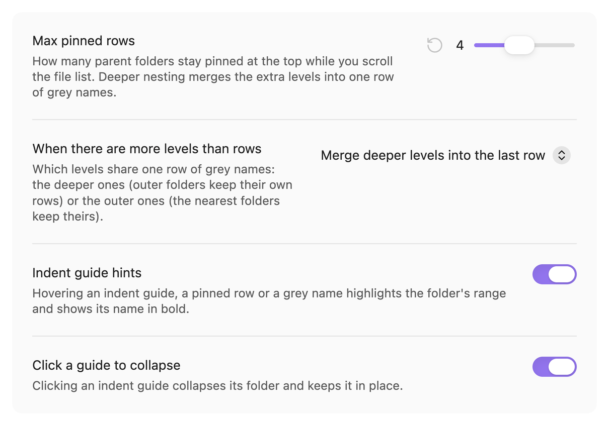

<h1 align="center">Sticky Folders</h1>

<p align="center">
  Keep parent folders pinned at the top of Obsidian's file explorer while you scroll,<br>
  so you always know which folder you are in, even five levels deep.
</p>

<p align="center">
  <a href="https://github.com/Tuosang/obsidian-sticky-folders/releases/latest"></a>
  <a href="https://github.com/Tuosang/obsidian-sticky-folders/releases"></a>
  
  
  <a href="LICENSE"></a>
</p>

<p align="center"><b>English</b> · <a href="README.zh-CN.md">简体中文</a></p>

<p align="center">
  
</p>

## Why

Vaults organised by date or project get deep fast: `Work / Meetings / 2026 / 2026-05 / 2026-05-21 / …`. Scroll a little and the folder rows slide out of view. All that is left are indent lines that don't say where they lead.

Sticky Folders keeps those parents on screen, the way VS Code's sticky scroll keeps the enclosing function visible.

<table>
  <tr>
    <th>Without Sticky Folders</th>
    <th>With Sticky Folders</th>
  </tr>
  <tr>
    <td></td>
    <td></td>
  </tr>
</table>

## Features

### Pinned parent folders

Every open parent folder of the top of the list gets its own pinned row, indented like the tree below it. When a folder ends, the next one pushes its row up. Pinned rows are copies of the real rows, so your theme's styling carries over.

### A row limit that never runs out of room

Choose how many rows may be pinned (1–8, default 4). When nesting goes deeper, the extra levels share one row: grey names for the merged parents, the folder you are in at the end. You decide which end merges.

<table>
  <tr>
    <th>Merge deeper levels into the last row (default)</th>
    <th>Merge outer levels into the first row</th>
  </tr>
  <tr>
    <td></td>
    <td></td>
  </tr>
</table>

### Indent guide hints

Hover an indent guide, a pinned row or a grey name. The folder's whole range lights up in your accent colour and its name turns bold, both in the tree and in the pinned rows. Click the guide to collapse that folder.

<p></p>

### Collapse in place

Click a pinned row, or one of the grey names, to collapse that folder. The list scrolls so the folder sits right under the rows that stay pinned, so you don't lose your place. Right-click a pinned row for Obsidian's usual folder menu.

### Fits in

- Light and dark themes.
- Works on mobile: tap a pinned row to collapse it. Hover hints need a mouse.
- Settings in English and Chinese, following Obsidian's language.

<table>
  <tr>
    <th>Dark theme</th>
    <th>Mobile</th>
  </tr>
  <tr>
    <td></td>
    <td></td>
  </tr>
</table>

## Installation

### Community plugins

Sticky Folders is not in Obsidian's community plugin list yet. Until it is, install it with BRAT or by hand.

### With BRAT

1. Install and enable [BRAT](https://github.com/TfTHacker/obsidian42-brat) from **Settings → Community plugins**.
2. Run **BRAT: Add a beta plugin for testing** from the command palette.
3. Enter `Tuosang/obsidian-sticky-folders` and choose the latest version.
4. Enable **Sticky Folders** under **Settings → Community plugins**.

BRAT also keeps the plugin up to date.

### Manually

1. Download `main.js`, `manifest.json` and `styles.css` from the [latest release](https://github.com/Tuosang/obsidian-sticky-folders/releases/latest).
2. Put them in `<your vault>/.obsidian/plugins/sticky-folders/`.
3. Reload Obsidian and enable **Sticky Folders** under **Settings → Community plugins**.

## Usage

There is nothing to set up. Open the file explorer and scroll.

| Action | What happens |
| --- | --- |
| Scroll the file list | Open parent folders stay pinned at the top |
| Hover an indent guide, pinned row or grey name | The folder's range is highlighted and its name turns bold |
| Click a pinned row or grey name | That folder collapses and stays in place |
| Click an indent guide | That folder collapses (can be turned off) |
| Right-click a pinned row | Obsidian's folder menu for that folder |
| Scroll over the pinned rows | The list scrolls as usual |

## Settings

| Setting | Default | What it does |
| --- | --- | --- |
| Max pinned rows | 4 | How many rows may be pinned at once (1–8) |
| When there are more levels than rows | Merge deeper levels into the last row | Which end shares one row of grey names |
| Indent guide hints | On | Highlight a folder's range and bold its name on hover |
| Click a guide to collapse | On | Clicking an indent guide collapses its folder |

The settings also show up in Obsidian's settings search, and each one has a button to reset it to the default.

<p></p>

## Compatibility

- Obsidian 1.13 or later. Developed and tested on Obsidian 1.13.7 on macOS, and in Obsidian's mobile layout.
- Works with Obsidian's core file explorer. Plugins that replace it with a view of their own are not supported.
- Tested with the default theme (light and dark) and a community theme. If a theme looks wrong, please [open an issue](https://github.com/Tuosang/obsidian-sticky-folders/issues) with a screenshot.

## Known limitations

- Dropping a file onto a pinned row does nothing. Drop it on the folder's real row, or on a subfolder below.
- Hover hints need a mouse. On touch screens, tap the pinned rows instead.
- The plugin relies on how Obsidian builds its file explorer, which a future Obsidian release could change. If something breaks after an update, please [open an issue](https://github.com/Tuosang/obsidian-sticky-folders/issues).

## Privacy

Sticky Folders makes no network requests and collects no data. It reads the file explorer on screen and never opens your notes. Its settings are stored in the plugin's own `data.json`.

## How it works

- Pinned rows are copies of the real folder rows, drawn in a zero-height `position: sticky` element at the top of the explorer's scroll container. Wheel, trackpad and touch scrolling over them keep working.
- Obsidian only renders the rows on screen, but the parents of those rows always stay in the page. The plugin measures them directly, so it never scans your vault.
- Collapsing uses the explorer's own folder items without animation, so the folder can stay in place. If Obsidian changes that internal API, the plugin falls back to clicking the real row.

## Development

```bash
git clone https://github.com/Tuosang/obsidian-sticky-folders.git
cd obsidian-sticky-folders
npm install
npm test          # layout logic in src/layout.ts
npm run lint      # the Obsidian community directory's ESLint rules
npm run build     # type-check and bundle into dist/
npm run dev       # rebuild on every change
```

To copy each build into a vault, put the vault's path in a git-ignored `.vault` file or set `STICKY_VAULT`.

To release, run `npm version patch` (it updates `manifest.json` and `versions.json`), then push the commit and a tag equal to the version without `v`, for example `git push && git push origin 0.1.1`. GitHub Actions builds the plugin and drafts a release with the three files.

## Changelog

See [CHANGELOG.md](CHANGELOG.md).

## Feedback

Bug reports and ideas are welcome in [issues](https://github.com/Tuosang/obsidian-sticky-folders/issues), in English or Chinese.

## Acknowledgements

Inspired by the sticky scroll in Visual Studio Code.

## License

[MIT](LICENSE) © 2026 Kevin Yan
