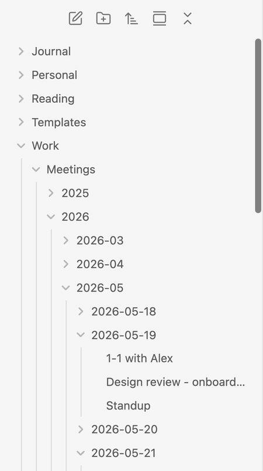
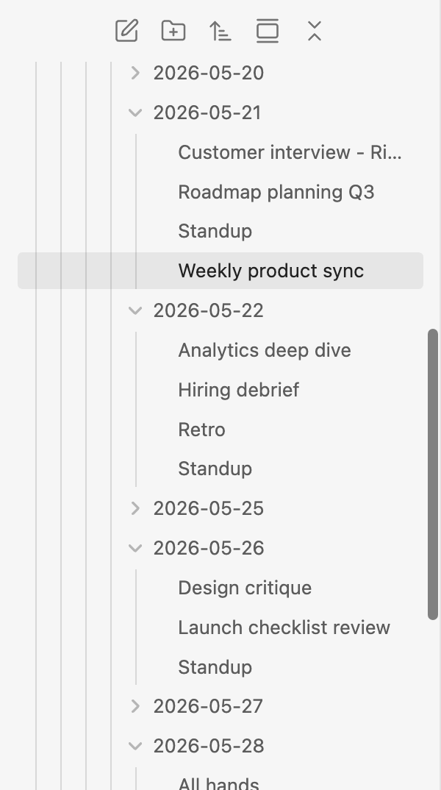
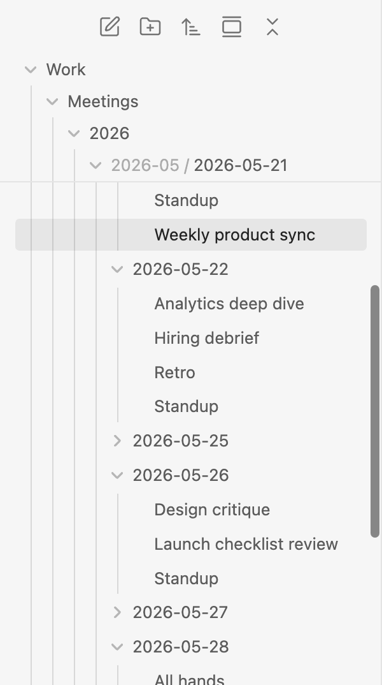
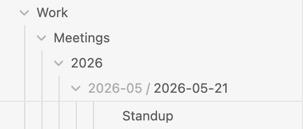
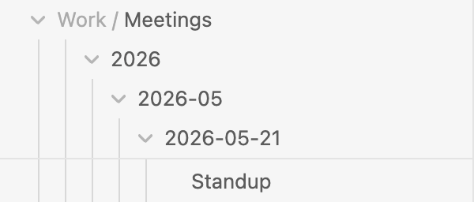
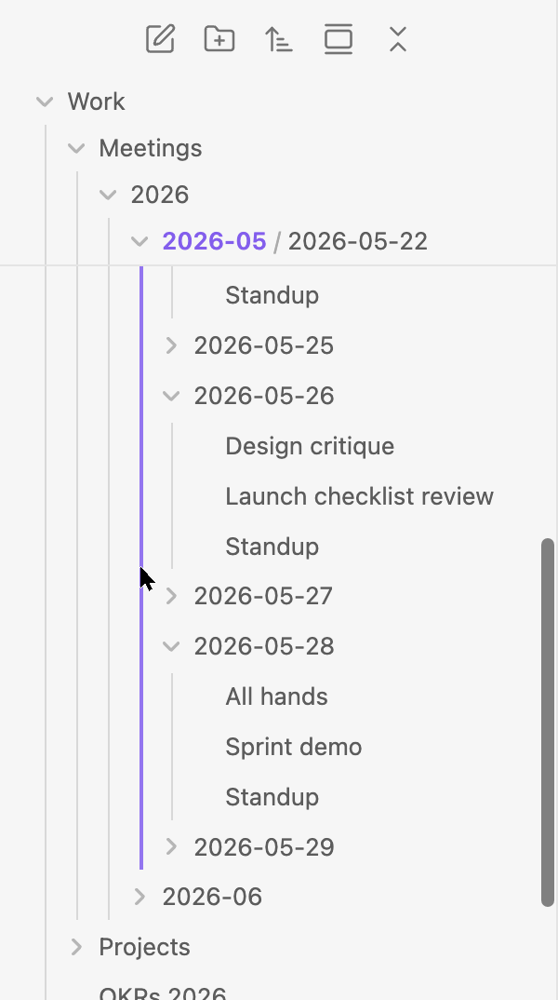
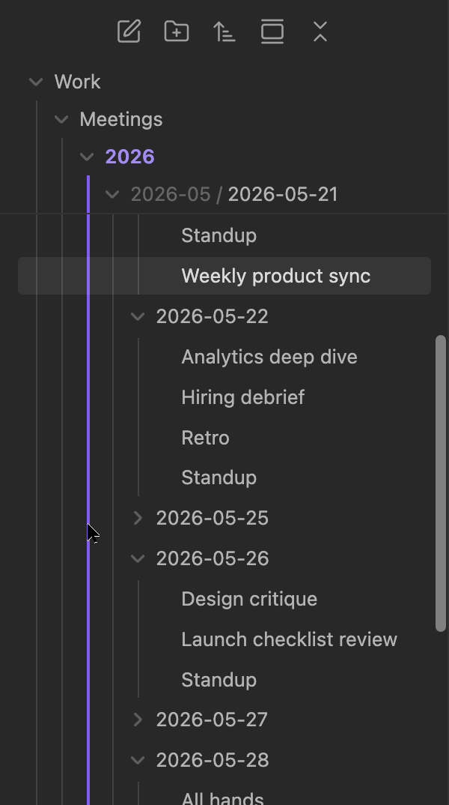
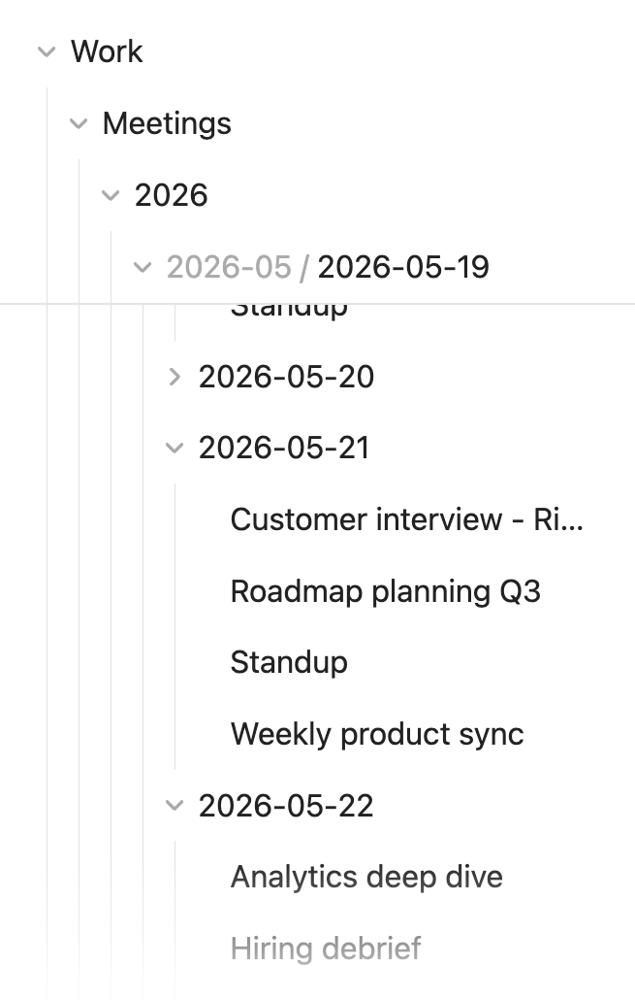
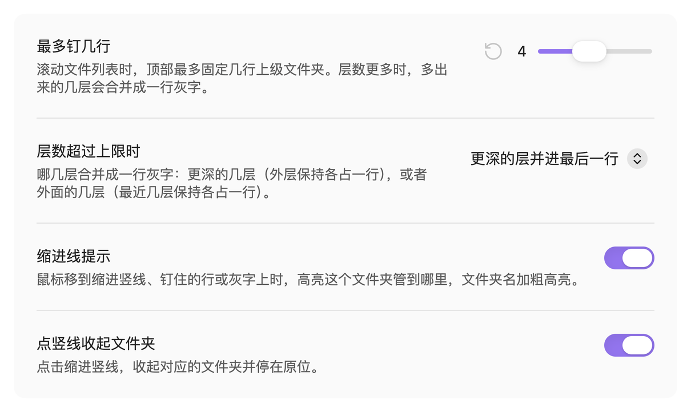

<h1 align="center">Sticky Folders · 文件夹吸顶</h1>

<p align="center">
  滚动 Obsidian 文件列表时，把上级文件夹钉在顶部，<br>
  就算钻到第五层，也随时知道自己在哪个文件夹里。
</p>

<p align="center">
  <a href="https://github.com/Tuosang/obsidian-sticky-folders/releases/latest"></a>
  <a href="https://github.com/Tuosang/obsidian-sticky-folders/releases"></a>
  
  
  <a href="LICENSE"></a>
</p>

<p align="center"><a href="README.md">English</a> · <b>简体中文</b></p>

<p align="center">
  
</p>

## 为什么需要它

按日期或项目整理的库很快就会变得很深，比如 `Work / Meetings / 2026 / 2026-05 / 2026-05-21 / …`。稍微往下一滚，上级文件夹的那一行就滑出了屏幕，只剩几条缩进竖线，看不出它们属于哪个文件夹。

Sticky Folders 把这些上级文件夹留在屏幕上，就像 VS Code 的 sticky scroll 会把当前所在的函数名留在顶部一样。

<table>
  <tr>
    <th>没有 Sticky Folders</th>
    <th>有 Sticky Folders</th>
  </tr>
  <tr>
    <td></td>
    <td></td>
  </tr>
</table>

## 功能

### 上级文件夹逐层钉住

列表顶部内容的每一层上级文件夹都各占一行钉在顶部，缩进和下面的树保持一致。一个文件夹到底了，下一个会把它那一行顶上去。钉住的行是真实文件夹行的复制，所以主题样式会照样生效。

### 行数有上限，层再深也放得下

可以设置最多钉几行（1–8 行，默认 4 行）。层数更深时，多出来的几层合并成一行：被合并的上级显示为灰字，你所在的文件夹放在最后。合并哪一端可以自己选。

<table>
  <tr>
    <th>更深的层并进最后一行（默认）</th>
    <th>外层并进第一行</th>
  </tr>
  <tr>
    <td></td>
    <td></td>
  </tr>
</table>

### 缩进线提示

鼠标移到缩进竖线、钉住的行或灰字上，这个文件夹管到哪里会整段用主题强调色高亮，文件夹名在树里和钉住的行里同时加粗高亮。点一下竖线，就能收起这个文件夹。

<p></p>

### 收起后停在原位

点钉住的行，或灰字里的某一级，就能收起对应的文件夹。列表会自动滚到让这个文件夹正好停在仍然钉住的行下方，不会丢失当前位置。右键钉住的行，会弹出 Obsidian 原本的文件夹菜单。

### 融入你的环境

- 支持浅色和深色主题。
- 手机上也能用：点钉住的行即可收起；悬停提示需要鼠标。
- 设置界面有中文和英文，跟随 Obsidian 的语言。

<table>
  <tr>
    <th>深色主题</th>
    <th>手机</th>
  </tr>
  <tr>
    <td></td>
    <td></td>
  </tr>
</table>

## 安装

### 社区插件市场

Sticky Folders 还没有上架 Obsidian 社区插件市场，目前请用 BRAT 或手动安装。

### 用 BRAT 安装

1. 在 **设置 → 第三方插件** 里安装并启用 [BRAT](https://github.com/TfTHacker/obsidian42-brat)。
2. 在命令面板运行 **BRAT: Add a beta plugin for testing**。
3. 填入 `Tuosang/obsidian-sticky-folders`，选择最新版本。
4. 在 **设置 → 第三方插件** 里启用 **Sticky Folders**。

之后 BRAT 会自动帮你更新插件。

### 手动安装

1. 从[最新版本](https://github.com/Tuosang/obsidian-sticky-folders/releases/latest)下载 `main.js`、`manifest.json`、`styles.css`。
2. 放进 `<你的库>/.obsidian/plugins/sticky-folders/`。
3. 重启 Obsidian，在 **设置 → 第三方插件** 里启用 **Sticky Folders**。

## 使用

不需要任何设置，打开文件列表滚动即可。

| 操作 | 效果 |
| --- | --- |
| 滚动文件列表 | 打开着的上级文件夹钉在顶部 |
| 鼠标移到缩进竖线、钉住的行或灰字上 | 高亮这个文件夹的范围，文件夹名加粗 |
| 点钉住的行或灰字 | 收起这个文件夹，并停在原位 |
| 点缩进竖线 | 收起这个文件夹（可关闭） |
| 右键钉住的行 | 弹出这个文件夹的 Obsidian 菜单 |
| 在钉住的行上滚动 | 列表照常滚动 |

## 设置

| 设置项 | 默认值 | 作用 |
| --- | --- | --- |
| 最多钉几行 | 4 | 同时最多钉住几行（1–8） |
| 层数超过上限时 | 更深的层并进最后一行 | 哪一端合并成一行灰字 |
| 缩进线提示 | 开 | 悬停时高亮文件夹范围、加粗文件夹名 |
| 点竖线收起文件夹 | 开 | 点击缩进竖线收起对应文件夹 |

这些设置也能在 Obsidian 的设置搜索里搜到，每一项都可以一键恢复默认值。

<p></p>

## 兼容性

- 需要 Obsidian 1.13 或更新版本。开发和测试环境是 macOS 上的 Obsidian 1.13.7，并在 Obsidian 的手机布局下测试过。
- 支持 Obsidian 自带的文件列表。用自己的视图替换文件列表的插件不在支持范围内。
- 在默认主题（浅色、深色）和一款社区主题下测试过。如果某个主题显示不正常，欢迎附上截图[提 issue](https://github.com/Tuosang/obsidian-sticky-folders/issues)。

## 已知限制

- 把文件拖到钉住的行上不会移动文件。请拖到文件夹真正的那一行，或者下面的子文件夹上。
- 悬停提示需要鼠标；触屏设备上请直接点钉住的行。
- 插件依赖 Obsidian 文件列表的内部结构，以后的 Obsidian 版本可能会改动。如果更新后出了问题，请[提 issue](https://github.com/Tuosang/obsidian-sticky-folders/issues)。

## 隐私

Sticky Folders 不联网，也不收集任何数据。它只读取屏幕上的文件列表，不会打开你的笔记。设置保存在插件自己的 `data.json` 里。

## 实现原理

- 钉住的行是真实文件夹行的复制，放在文件列表滚动容器顶部一个高度为 0 的 `position: sticky` 元素里，所以在它们上面用滚轮、触控板或手指滑动都照常滚动。
- Obsidian 只渲染屏幕上的行，但这些行的上级文件夹始终留在页面里。插件直接测量它们的位置，不需要扫描整个库。
- 收起文件夹时调用文件列表自己的文件夹对象，并且不带动画，这样文件夹能停在原位。如果 Obsidian 改了这个内部接口，插件会改为模拟点击真实的那一行。

## 开发

```bash
git clone https://github.com/Tuosang/obsidian-sticky-folders.git
cd obsidian-sticky-folders
npm install
npm test          # 测试 src/layout.ts 里的布局逻辑
npm run lint      # 用 Obsidian 社区插件市场的 ESLint 规则检查代码
npm run build     # 类型检查并打包到 dist/
npm run dev       # 每次改动后自动重新打包
```

想让每次打包自动装进某个库，把库的路径写进 `.vault` 文件（不会提交到 git），或者设置 `STICKY_VAULT` 环境变量。

发布新版本：运行 `npm version patch`（会同步更新 `manifest.json` 和 `versions.json`），然后推送提交和一个与版本号相同、不带 `v` 的标签，例如 `git push && git push origin 0.1.1`。GitHub Actions 会自动打包，并生成一个包含三个插件文件的草稿 Release。

## 更新日志

见 [CHANGELOG.md](CHANGELOG.md)。

## 反馈

欢迎在 [issues](https://github.com/Tuosang/obsidian-sticky-folders/issues) 里反馈问题或提建议，中文、英文都可以。

## 致谢

灵感来自 Visual Studio Code 的 sticky scroll。

## 许可证

[MIT](LICENSE) © 2026 Kevin Yan
